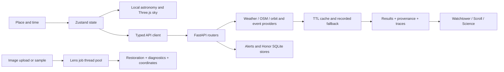

# Tsukuyomi Watch: pitch and codebase guide

Based on the implementation inspected on 30 October 2026. This guide distinguishes implemented code from claims that require a live demonstration. Older README guidelines and AGENT_BRIEF contain planned features and outdated mock-only descriptions.

Verification during this preparation: `backend/.venv/Scripts/python.exe -m pytest -q` from `backend/` completed with **39 passed**, with one dependency deprecation warning. This is automated backend coverage, not a live verification of every external provider or the current frontend.

## The sentence to remember

**Tsukuyomi Watch helps you decide what to observe, where to go, when to go, and how to inspect the image you bring back.**

For a beginner, it reduces the work of combining a star chart, weather forecast, event calendar and image-processing tool. For an enthusiast, it exposes the calculations and image-quality checks behind the result.

## A 60-second pitch

“Someone planning a night of stargazing has several separate questions: what is visible, whether the weather will cooperate, where the sky is darker, and what their camera actually captured.

Tsukuyomi Watch connects those steps. You start in a sky calculated for your location and time. Watchtower scores observing conditions hour by hour and ranks nearby places. Celestial Scroll brings together Moon, planet, meteor, eclipse, satellite and launch information, with reminders and calendar export.

After observing, Spirit Lens processes your photo using measured noise and blur. The Dojo lets you compare the original, restoration and residual, and inspect detections. We expose the method, source and limitations so users can challenge the result.

Our central idea is a complete observing journey: plan, observe, inspect and record. The Japanese night-sky design gives that journey a consistent visual language.”

Do not promise a clear sky or a confirmed discovery. Present recommendations and detections as estimates supported by their inputs.

## Features: what each part does

| Part | User benefit | Implementation and caveat |
|---|---|---|
| Living Sky | Explore the sky from the selected place and simulated time | React Three Fiber/Three.js scene; catalogue coordinates and astronomy-engine calculations. The presentation includes stylized visual effects. |
| Location and time compass | Change the observing context and preview the sky | Zustand stores place, timezone and a time offset clamped to ±72 hours. Sky objects are recomputed locally. API cards use separately fetched per-place data; do not claim every card follows every time-dial movement. |
| Watchtower | Decide whether tonight is worth the trip | Hourly Night Honor Score, contribution breakdown, best consecutive observing window, Go/Maybe/Stay in verdict and dew/cold/wind warnings. |
| Nearby spots | Compare real candidate places | Overpass discovers peaks, viewpoints and named elevated places of worship. Per-spot forecast, estimated darkness, elevation and straight-line distance drive ranking. It does not verify road access, opening hours or safety. |
| Celestial Scroll | Know what is happening and when | Moon, Sun, lunar calendar, meteor estimates, planets, local eclipse information, ISS passes, launches and unified events. A global launch is not necessarily visible locally. |
| Reminders | Remember an observing opportunity | Calendar .ics download and Web Push. Push needs permission, a working subscription and a running backend worker. |
| Spirit Lens | Reduce noise and blur in an astronomical image | Real upload/sample API, asynchronous jobs and nine processing stages. JPG, PNG, TIFF and FITS are accepted. |
| Dojo | Inspect what restoration changed | Before/after katana slider, residual view, detections, PSF, photometric checks and an injection benchmark. Explicit mock route exists for a labelled fallback. |
| Sky identification | Connect pixels to a sky field | FITS WCS/AVM metadata, optional astrometry.net solve, SkyView cutout and backend SIMBAD lookup. Blind solving needs the optional API key; unknown coordinates remain unknown. |
| Transients | Explore changing astronomical sources | ALeRCE/ZTF records, light curves, cutouts and our two-image subtraction pipeline. Broker class probabilities come from ALeRCE; the project does not train that classifier. |
| Honor | Keep an observing journal and earn ranks | SQLite ledger, anonymous browser ID and server-side plausibility rules. A possible observation is not proof the person actually made it. |
| Science | Explain sources and computations | Provenance, timestamps, traces, formulas and limitations. Open a real result's information panel during the pitch. |
| Field/Lite/PWA | Use the product on weaker devices and outdoors | Red field palette, reduced-motion/Lite paths and production service-worker caching. Offline supports cached content, not new server-side image jobs or unseen data. |

## The complete user flow

1. Enter through the gate and select or resolve a location.
2. Watch or skip the introduction; enter the sky.
3. Explore a target and move the time compass to understand its position.
4. Open Watchtower: read the verdict, inspect the limiting factor, compare the best window and spots.
5. Open Scroll: choose an event, check local visibility and timing, export a calendar entry or schedule a reminder.
6. Observe outside the app; take a photo if available.
7. Open Lens: choose a known sample or upload, set processing parameters and submit.
8. Wait for the pipeline stages; open the finished job in Dojo.
9. Compare original/restored/residual, inspect detections and run the synthetic-star benchmark.
10. Record an observation in Honor. The server checks whether the claim is plausible and returns a reason and points.

The useful story is **one night of observing**. Avoid turning the demo into a tour of every menu.

## A three-minute demo

| Time | Action | What to say |
|---|---|---|
| 0:00–0:25 | Enter, select a city, skip intro if needed | “This sky uses our selected location and time.” |
| 0:25–0:45 | Move the time compass; select the Moon or a named object | “Astronomical positions update locally, so exploring time does not require a request per frame.” |
| 0:45–1:25 | Watchtower: verdict → breakdown → window → spot | “Here is the decision, its main cause, and a nearby alternative. These inputs and weights explain the score.” |
| 1:25–1:45 | Scroll: one locally relevant event and calendar export | “This turns an interesting sky event into a plan.” |
| 1:45–2:35 | Open a precomputed real Lens job in Dojo | “We measured blur from sources in the image. This residual tests how well the restoration explains the original.” |
| 2:35–3:00 | Show honesty notes, then Honor or Science | “We make both the result and its limitations inspectable. That is the connection from planning to understanding.” |

Prepare one synthetic job for known-truth checks and one real sample with coordinates. Use the actual measured numbers from those jobs. Processing a large upload or waiting for a cold Overpass query can consume the entire demo.

## Explain the architecture in 30 seconds

“The main frontend is a TypeScript React app built with Vite. Three.js renders the sky; Zustand holds shared location and time; a typed API client calls FastAPI. Astronomy that needs to react immediately runs in the browser. Python handles provider requests, scoring, event aggregation, image analysis and observation rules. External responses are cached and carry provenance. Image work runs in a small thread pool, while SQLite stores alerts and the journal.”

The repository also contains `frontend-basic`, a simpler API test interface. `frontend-main` is the main product UI. Do not describe them as two backend services.

## Codebase map: learn these files first

| Path | Responsibility |
|---|---|
| `frontend-main/src/app/App.tsx` | App composition and route rendering |
| `frontend-main/src/app/routes.tsx` | Lazy module imports and chapter metadata |
| `frontend-main/src/state/store.ts` | Place, timezone, phase, simulated time, quality and field settings |
| `frontend-main/src/astro/skytime.ts` | Sun/Moon/planet calculations and rise/set helpers |
| `frontend-main/src/astro/coords.ts` | Celestial coordinates → local horizontal directions → scene vectors |
| `frontend-main/src/scene/sky/` | Stars, Moon, planets, overlays and sky interaction |
| `frontend-main/src/scene/Director.ts` | Camera/navigation transitions |
| `frontend-main/src/data/api.ts` | Typed requests, response envelopes and endpoint groups |
| `frontend-main/src/data/tonight.ts` | Shared per-place data and memo cache |
| `frontend-main/src/modules/` | Watchtower, Scroll, Lens, Dojo, Honor and Science pages |
| `backend/app/main.py` | FastAPI setup, routers, startup tasks and provider error handler |
| `backend/app/core/http.py` | Provider fetch, retry, stale-cache and replay behavior |
| `backend/app/core/envelope.py` | Provenance and calculation-trace models |
| `backend/app/watchtower/score.py` | Hourly condition score and best-window logic |
| `backend/app/watchtower/spots.py` | OSM candidate discovery and ranking |
| `backend/app/scroll/` | Moon, Sun, planets, meteors, eclipses, passes, launches and events |
| `backend/app/lens/jobs.py` | Job store, background execution and pipeline orchestration |
| `backend/app/lens/restore.py` | Wavelet denoise and Richardson–Lucy deconvolution |
| `backend/app/lens/honesty.py` | Residual, flux, position and structural checks |
| `backend/app/transients/subtract.py` | Two-epoch image comparison |
| `backend/app/honor/rules.py` | Plausibility checks and points |
| `backend/app/alerts/` | Subscriptions, scheduled alerts and delivery worker |
| `backend/tests/` | Scientific logic, routes and regression checks |

## Trace two requests out loud

**Watchtower:** the page reads the shared score slice → `data/tonight.ts` calls `api.watchtower.score` → FastAPI's Watchtower router fetches weather and optional air/light-pollution inputs → `compute_night_score` calculates hourly astronomy and weighted qualities → the response includes score, best window, verdict, provenance and trace → the UI renders the chart and breakdown.

**Lens:** choose a file/sample → `POST /api/lens/jobs` returns a job ID → a two-worker thread pool runs the pipeline → the browser polls the job every 800 ms → a finished result exposes image URLs and metrics → `/dojo/:id` displays comparison and inspection controls. Finished jobs are persisted and can be reloaded from disk; interrupted jobs need resubmission.

## Technical explanations judges may ask for

### How is the Night Honor Score calculated?

`score = 100 × darkness_gate × weighted_mean(available factor qualities)`

| Factor | Base weight |
|---|---:|
| Low cloud | 30% |
| Mid cloud | 15% |
| High cloud | 8% |
| Humidity | 12% |
| Transparency: visibility/aerosols | 10% |
| Moonlight | 15% |
| Light pollution | 10% |

Qualities run from 0 to 1. The darkness gate is zero when the Sun is at or above −6°, one at or below −18°, and linear between. Missing factors are excluded and remaining weights renormalized. A missing input therefore changes the evidence behind the score.

The default best window is the highest mean across two consecutive hourly samples. A score of at least 70 gives Go, 45–69.9 gives Maybe, and below 45 gives Stay in. These weights and thresholds are transparent engineering choices; they are not a scientifically calibrated probability of success.

### How are spots ranked?

`rank = night_score × darkness_factor × elevation_bonus − distance_penalty`

Candidates are shortlisted for promise and geographic diversity before forecast scoring. Distance is haversine distance, not road travel time. Darkness is an approximate Bortle estimate derived from a rendered satellite nighttime-light image; it is not a ground-measured sky-brightness reading. Elevation is a modest proxy, not a terrain-horizon simulation.

### What happens inside Lens?

`load → background → detect → psf → denoise → deblur → honesty → classify → wcs`

- **Background/noise:** estimate the unwanted baseline and local noise.
- **Detection:** find sources above a noise-relative threshold and measure properties.
- **PSF:** estimate how the imaging system spreads a point-like source.
- **Denoise:** BayesShrink wavelet processing reduces coefficients consistent with noise.
- **Deblur:** Richardson–Lucy iteratively estimates a sharper image under the measured blur model. Auto mode checks progress at five-iteration intervals up to 30; it stops near the noise floor, on small improvement or worsening. Unknown PSF means deblurring is skipped.
- **Honesty:** compare the restoration against the original and its noise model.
- **Classification:** use source measurements for star/galaxy/unknown labels; these are estimates.
- **WCS:** map image pixels to celestial coordinates when metadata or a successful solve supports it.

This restoration is classical numerical processing. There is no trained generative image model in this pipeline. Avoid selling it as a newly trained AI model.

### What does “Proof of Honesty” actually prove?

It provides diagnostics, not an absolute guarantee. Re-blur the restored image with the PSF and compare that prediction to the original. Look at noise-normalized residuals, spatial structure, source flux and centroid movement.

The current `noise-like` verdict is based on the residual structure score being below 2.5; it does not require reduced chi-squared to pass a separate threshold. Read both values. SSIM and PSNR compare original and restored images; without ground truth they measure change, not restoration accuracy. “Invented pixels” counts connected residual excursions beyond a threshold; zero does not prove that every recovered detail is true.

The injection benchmark adds known synthetic stars, measures recovery and errors, and compares with a detection baseline. It tests the method on that image and parameter setting; quote that result rather than promising a universal recovery rate.

## Judge questions and concise answers

**Why would someone use this instead of a sky map?**
“The value is the connected observing workflow: local sky, conditions, candidate places, reminders, image inspection and a journal. We would validate its usefulness with observing clubs and first-time users.”

**Is this just a collection of APIs?**
“Providers supply weather, places and catalogue/event data. Our code combines them into explainable hourly scoring, spot ranking and event presentation, and implements the restoration checks, image subtraction and observation rules. We use established astronomy and image-processing libraries rather than claiming to have invented their algorithms.”

**Where is the AI?**
“Our restoration uses deterministic wavelets and deconvolution. Transient class probabilities come from ALeRCE's classifier. We can show exactly which component computed each result.”

**Can you guarantee no hallucinations?**
“No. We avoid generative reconstruction and expose residual and photometric checks. Wrong PSFs, noise assumptions or excessive deconvolution can still produce artifacts.”

**Does Honor prove someone observed the object?**
“It checks astronomical plausibility at the supplied place and time. It does not establish identity, physical attendance or that the attached photo depicts the claimed event. Stronger claim-to-photo matching and abuse prevention would be future work.”

**What happens if the APIs fail?**
“The shared provider helper tries fresh cache, live requests with retries, stale cache, then optional recorded replay. Returned data identifies its source and stale state. Without usable data it reports a provider error. Cached and replayed responses have limits; offline is not a promise of fresh forecasts.”

**How do you scale it?**
“The prototype uses a two-thread image worker pool, local files and SQLite. For a larger deployment we would add a durable job queue, separate processing workers, shared storage/cache, authentication and request/resource limits. We have not established production capacity.”

**Why the Japanese theme?**
“The Moon, lunar calendar, watchtower and journal give the product a coherent observing story. We retain direct navigation, readable numbers and Lite/reduced-motion modes so the presentation does not block the task.”

**How do you know the results are correct?**
“We have tests for scoring, events, restoration checks, transients, alerts and Honor. We can show a known-truth synthetic image and inspect the real diagnostic output. External catalogue comparisons and observing-session validation would strengthen the evidence.”

**What is unfinished?**
“Scientific calibration of the observing score and Bortle proxy, robust user identity and abuse controls, production job/storage infrastructure, broader device testing and field validation. Some older planning documents describe features beyond what is implemented.”

**Who is the first user and how would you measure success?**
“A student astronomy club planning a local observing night is a practical first group. Proposed measures are time to choose an observing plan, successful reminder delivery, repeat use and restoration recovery/error measurements. We do not yet claim adoption or impact numbers.”

## Demo preparation and failure recovery

1. Run the backend on port 8000 and main frontend on port 3000. Confirm `/api/health` and open `/docs`.
2. Warm the exact city and nearby-spots query you will show; upstream discovery can be slow.
3. Process the two sample jobs beforehand and keep their real IDs/URLs ready.
4. Inspect the actual verdict, residual notes, flux ratio and benchmark result. Be ready to show an imperfect result honestly.
5. Test a notification on the actual browser if push is part of the demo; otherwise demonstrate calendar export.
6. Test production preview for PWA/offline behavior. The development service worker only handles push.
7. If the 3D presentation causes trouble, use Lite mode/direct module navigation. If providers fail, disclose cached/replay data. If Lens is unreachable, `/dojo/mock-42` is an explicitly labelled interface simulation, not scientific evidence.

## Practice until you can answer without reading

1. Explain the user problem in 15 seconds without naming a framework.
2. Explain the entire observing journey in 30 seconds.
3. Trace Watchtower from a React page to a Python function and back.
4. Explain PSF, residual and WCS in one sentence each.
5. Explain why a noise-like verdict or zero flagged pixels is not a guarantee.
6. Name one provider failure path, one scientific approximation and one scaling limit.
7. Show one actual output that supports your strongest claim.

Useful vocabulary: **altitude** = angle above the horizon; **azimuth** = compass direction; **RA/Dec** = sky coordinates; **PSF** = the blur of a point source; **FWHM** = width of that blur at half its peak; **flux** = measured brightness; **WCS** = mapping pixels to sky coordinates; **residual** = original minus model prediction; **transient** = a source whose observed brightness changes over time.
